# Mersal Media Studio — Complete Architecture & Platform Documentation
> **Enterprise Photography Studio Management & Client Photo Proofing Platform**  
> *Crafted for Mersal Media by Ask*

---

## 1. Executive Summary & Vision

**Mersal Media Studio** is an all-in-one, production-grade photography studio operating system and client photo proofing platform. It combines high-end studio business operations (event tracking, client directories, payment ledgers, gear inventory, crew scheduling, and a 14-stage production pipeline) with a luxury customer-facing photo selection experience.

### Architecture Highlights
- **100% Offline-Capable & Serverless:** Zero dependency on external backend APIs, databases, or paid SaaS platforms. Everything operates with local persistence in browser `localStorage`.
- **Two Disjoint Experiences:**
  1. **Studio Management Portal:** Accessible via demo authentication (`/login` with `studio` / `1234`), providing full CRUD, calendar scheduling, revenue charts, and gear management.
  2. **Customer Photo Selection Portal:** Public URLs (`/gallery/:shareId`), completely free of studio login, optimized for mobile touch proofing with 1-photo-per-screen focus mode, pinch-to-zoom, and celebratory selection submissions.
- **Cinematic Dark Teal & Cyan Design:** Styled with `#000F13` background, `#092328` surface, and `#50E2E5` neon cyan accents, complemented by an instant Light mode toggle.

---

## 2. Technology Stack

| Layer | Technologies |
|:---|:---|
| **Core Framework** | React 18, TypeScript, Vite 8 |
| **Styling & Design** | Tailwind CSS 3.4, Custom CSS variables, Glassmorphism |
| **State Management** | Zustand (persistent stores with automated local storage synchronization) |
| **Routing** | React Router v6 with `createBrowserRouter` & route guards |
| **Icons & Visuals** | Lucide React, Canvas Confetti |
| **Charts & Analytics** | Recharts (Responsive bar charts & donut portfolios) |
| **Zoom & Gestures** | `react-zoom-pan-pinch`, custom touch swipe handlers |
| **Audio Feedback** | HTML5 Web Audio API (real-time synthesized frequency ramp pop sound) |
| **Exports & Reporting** | Client-side CSV generation, JSON manifest exports, print-to-PDF receipts |

---

## 3. Application Structure & Route Map

```
/
├── /login                            # Studio Demo Authentication
├── /dashboard                        # 10 KPI cards, revenue charts, upcoming shoots
├── /events                           # Complete event management, card & table views
│   ├── /events/new                   # Schedule new shoot modal
│   ├── /events/:id                   # Detailed tabs (Overview, Payments, Gear, Crew, Workflow)
│   └── /events/:id/edit              # Edit shoot modal
├── /clients                          # Customer directory & booking history
│   └── /clients/:id                  # Client profile, WhatsApp direct link, booking timeline
├── /calendar                         # Interactive shoot calendar (Month & List views, conflict alerts)
├── /payments                         # Accounts ledger, advance tracking, printable receipts, CSV export
├── /equipment                        # Cameras, lenses, drones, lighting, condition & event allocation
├── /team                             # Crew roster, photographers, cinematographers, drone pilots
├── /workflow                         # 14-stage visual production timeline & Kanban matrix
├── /galleries                        # Client proofing manager, Drive folder integration, QR share
│   └── /galleries/:id                # Photo manager, import client selection JSON, export filenames
├── /settings                         # Studio profile, theme switch, PIN update, full backup & restore
└── /gallery/:shareId                 # PUBLIC CUSTOMER PROOFING (No login required)
    ├── /gallery/:shareId/favourites  # Shortlist filter
    └── /gallery/:shareId/complete    # Selection report & WhatsApp notification
```

---

## 4. Key Performance Indicators (Studio Dashboard)

The studio dashboard automatically aggregates live data from the local store:

1. **Total Events:** Total number of shoots across all categories.
2. **Upcoming Shoots:** Events with status *Booked*, *Confirmed*, or *Shoot Scheduled*.
3. **Completed Shoots:** Fully delivered client shoots.
4. **Ongoing Shoots:** Shoots currently in progress on location.
5. **Pending Editing:** Projects currently undergoing raw processing and color grading.
6. **Pending Album Delivery:** Shoots at album designing or printing stages.
7. **Total Contract Value:** Sum of all finalized contract amounts in INR (₹).
8. **Total Received Payments:** Sum of all recorded client advance and milestone payments.
9. **Outstanding Balance:** Auto-calculated difference (`Total Contract - Total Received`).
10. **Total Clients:** Registered customer directory count.

---

## 5. Complete 14-Stage Photography Workflow

Every event is automatically tracked through a standard 14-stage milestone pipeline:

```mermaid
flowchart LR
    S1[1. Booking Confirmed] --> S2[2. Pre-Shoot Prep]
    S2 --> S3[3. Equipment Assigned]
    S3 --> S4[4. Team Assigned]
    S4 --> S5[5. Shoot Completed]
    S5 --> S6[6. Raw Ingest]
    S6 --> S7[7. Gallery Shared]
    S7 --> S8[8. Selection Active]
    S8 --> S9[9. Selection Submitted]
    S9 --> S10[10. Photo Editing]
    S10 --> S11[11. Album Designing]
    S11 --> S12[12. Client Approval]
    S12 --> S13[13. Album Printing]
    S13 --> S14[14. Final Delivery]
```



Each stage supports **Pending**, **In Progress**, **Completed**, and **Blocked** statuses, updating both the timeline and the overall completion percentage.

---

## 6. Client Photo Proofing Workflow

### Customer Experience (`/gallery/:shareId`)
1. **Public Access:** The client opens their personal URL sent via WhatsApp or email. No password or login is required.
2. **Branded Hero Cover:** Displays the ceremony name, welcome message, and an album progress bar.
3. **Dual View Modes:**
   - **Grid View:** Responsive masonry grid with hover overlay, filename badges, and instant heart toggle.
   - **Focus View (1 Photo per Screen):** The hallmark Mersal Media viewing experience. Fullscreen focus with swipe gestures on mobile, keyboard arrows, and double-tap to favorite.
4. **Haptic & Sound Feedback:** Favoriting triggers a synthesized pop sound via the Web Audio API and a YouTube-style particle burst animation.
5. **Pinch-to-Zoom Lightbox:** Single-tap opens a full-screen zoom/pan modal powered by `react-zoom-pan-pinch`.
6. **Final Submission & Celebration:**
   - Client reviews shortlisted photos and adds notes (e.g., choice of cover photo).
   - Clicking Submit triggers a **canvas-confetti** celebration explosion.
   - The customer can download `Selection_Report.json` or `Selection_Filenames.csv`.
   - A single click on the WhatsApp button generates a prefilled message to the studio director.

### Studio Selection Import (`/galleries/:id`)
Because the app runs without a cloud backend, customer selections on their device are exported as a `Selection_Report.json`. The studio director can simply click **"Import Selection JSON"** in the gallery manager:
- The file is parsed and validated locally.
- The gallery status shifts to **Submitted**.
- The linked event automatically advances to **Album Designing**.
- An in-app notification is posted to the studio dashboard.
- The studio can export all selected filenames to CSV for Lightroom/Capture One filtering.

---

## 7. Commercial & Financial Management

- **Event Contracts:** Captures contract total, discount, final amount, advance, and due date.
- **Payment Ledger:** Tracks date, amount, payment method (UPI, NEFT/IMPS, Cash, Card, Cheque), and transaction reference (UTR).
- **Printable Branded Receipts:** Instant pop-up digital receipt with studio registration, address, contact info, customer name, amount in words, and authorized signature block.
- **CSV Data Exports:** One-click export of payment history to CSV for studio accountants.

---

## 8. Seed Demo Dataset

On first launch, the app populates realistic Tamil Nadu photography studio data:
- **12 Events:** Including weddings at MRC Centre Chennai, temple muhurthams at Madurai, pre-wedding shoots in Ooty, engagements in Salem, and corporate summits at Leela Palace.
- **10 Clients:** Realistic Tamil and South Indian couples and corporate clients.
- **20 Payments:** Advance and milestone payments across UPI, NEFT, and Cash.
- **15 Equipment Records:** Sony FX3, Sony A7M4, Canon R5, GM prime lenses, DJI Mavic 3 Pro drones, and Godox strobes.
- **8 Studio Crew Members:** Creative directors, candid photographers, cinematographers, drone pilots, editors, and album designers.
- **5 Client Galleries:** Including seeded high-resolution wedding proofs.

---

## 9. Security, Offline Persistence & Backup

- **Demo Authentication:** Frontend authentication for studio access (`studio` / `1234`).
- **Data Persistence:** Managed via versioned localStorage keys (`mersal_auth`, `mersal_events`, `mersal_clients`, `mersal_payments`, `mersal_equipment`, `mersal_team`, `mersal_galleries`, `mersal_workflows`).
- **Customer Isolation:** Customer favourite selections are namespaced per gallery (`mersal_gallery_favs_<galleryId>`).
- **Backup & Restore:** Full one-click JSON dump and restore feature in Settings to migrate or archive studio databases.
- **Reset Functionality:** Instant "Reset Demo Data" option to re-seed the platform for presentations.
